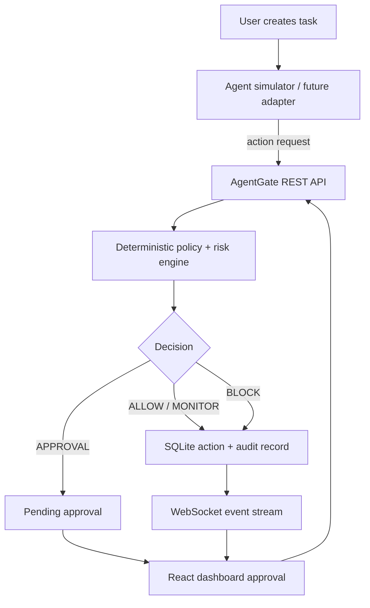
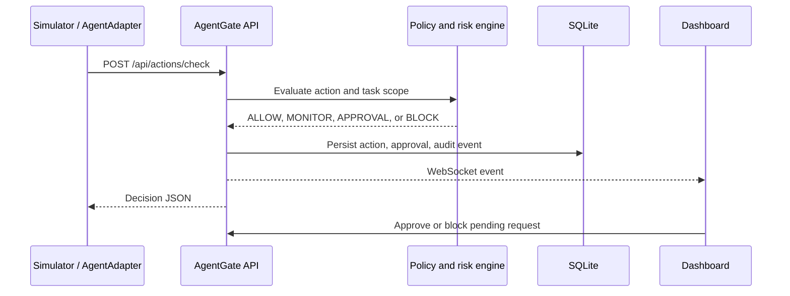

# AgentGate

**AgentGate: A Runtime Security Firewall for AI Coding Agents** is a local V2 prototype that evaluates agent action requests outside the model. It includes deterministic policy and risk engines, SQLite audit persistence, approvals, a simulator, REST and WebSocket APIs, and a React dashboard.

> The included simulator is not a Codex interception mechanism. It submits action descriptions to the AgentGate API. AgentGate never runs shell commands, reads or writes the requested target file, contacts external destinations, or exposes actual credentials. “Execute” and approval of an action only record a simulated authorization result.

## Architecture





## Features

- Tasks with declared workspace scope; action checks associate each action with a task.
- Path normalization and resolved symlink containment checks.
- Deterministic rules for secrets, private key paths, personal documents, dangerous commands, and network destinations.
- Approval queue with single-use allow or reject resolution.
- SQLite tables for tasks, actions, approvals, audit events, and policies.
- Live WebSocket action and approval events; dashboard reads persisted API data.
- Eight-scenario safe security demo and standalone simulator.
- `AgentAdapter` abstraction with `SimulatorAdapter` example for later integrations.

## Technology

Python, FastAPI, Pydantic, SQLAlchemy, SQLite, Uvicorn, pytest; React, TypeScript, Vite, Tailwind CSS, Recharts, and Lucide icons.

## Prerequisites and installation

Python 3.11+ and Node.js 20+ are recommended. In PowerShell at the project root:

```powershell
py -3.11 -m venv .venv
.\.venv\Scripts\Activate.ps1
python -m pip install -r backend\requirements.txt
cd frontend
npm install
```

If `py -3.11` is unavailable, install Python 3.11+ and use its `python` executable to create the environment.

## Run AgentGate

Terminal 1:

```powershell
cd backend
..\.venv\Scripts\python.exe -m uvicorn app.main:app --reload --port 8001
```

Backend: <http://127.0.0.1:8001> · API docs: <http://127.0.0.1:8001/docs> · health: <http://127.0.0.1:8001/health>

Terminal 2:

```powershell
cd frontend
npm run dev
```

Dashboard: <http://localhost:5173>

SQLite database is created at `agentgate.db` in the repository root. The controlled fixture is `controlled_workspace/` and contains dummy-only content.

## Demo

1. Start the backend and frontend.
2. The dashboard's **Run simulated security demo** button submits simulator records for testing.
3. Overview keeps the simulator feed separate; Live Monitor fetches `source=runtime` and excludes old and new simulator records.
4. Review durable simulator and runtime records under Audit Log.

The standalone simulator can be run with:

```powershell
python simulator\agent_simulator.py
```

To attach it to an existing task, pass `--task-id TASK-ID`. It submits the listed descriptions only; it never executes them.

## Security model and threat model

All decisions are made server-side by deterministic rules. Low-risk in-workspace reads and recognized test commands are allowed; unknown activity may be monitored; sensitive configuration requests require approval; SSH/private key paths, personal documents, outside-workspace paths, and destructive command patterns are blocked. Unknown external network destinations require approval, while localhost is trusted and designated test domains are blocked. A user decision can authorize only the simulated acknowledgement; this prototype does not actually execute approved actions.

The model demonstrates an action-gating architecture against unsafe agent requests. It does not sandbox arbitrary third-party processes, inspect OS-level syscalls, authenticate API clients, defend the local host against a compromised backend, or provide production-grade policy administration. Do not expose this local unauthenticated prototype to an untrusted network or put real secrets in fixture files.

## Testing

From the repository root:

```powershell
python -m pytest backend\tests -q
```

Tests cover the requested policy cases, path traversal, symlink escapes, approval, audit persistence, and WebSocket event delivery.

## Limitations and future work

- Simulator actions are requests rather than OS-level interception; there is no real Codex adapter.
- “Execution” is an audit-marked simulation, not file or command execution.
- Authentication, multi-user approval identity, policy editing, Postgres migrations, and production deployment hardening are not included.
- Future work: add an authenticated agent adapter, OS sandbox integration, signed policy bundles, richer task relevance rules, and a production database backend.

## V3 Phase 1: Windows runtime observation (observation only)

On Windows, the backend automatically starts a recursive workspace watcher from the FastAPI lifespan when `uvicorn app.main:app` starts. It stops during FastAPI shutdown. The dashboard reports `Runtime Source: WINDOWS MONITOR` while active and `Runtime Source: NOT ACTIVE` otherwise. Simulator records remain available separately and do not determine the runtime source. Runtime file events use the existing action evaluation, risk, SQLite audit, and WebSocket pipeline; no SQLite schema change is needed.

The monitor uses the Windows `ReadDirectoryChangesW` API through Python `ctypes`, watching only `controlled_workspace` recursively. Its filter requests file-name and last-write notifications and intentionally excludes last-access notifications. Nested resources are sent relative to the workspace root, such as `real_agent_demo/index.html`. Accordingly:

- It receives file-name and last-write notifications only inside the controlled workspace. Create and last-write notifications map to the existing WRITE action with `filesystem_event` metadata distinguishing creation from last-write evidence; removal maps to DELETE. Rename notifications are represented as DELETE for the old name and WRITE for the new name because the existing action vocabulary has no dedicated rename type. Events pass through the existing policy/risk path.
- `ReadDirectoryChangesW` does not report the PID that caused a file notification. Such actions use `pid: null`, `process_name: null`, and `process_path: null`; selected-process identity is retained as contextual metadata and explicitly marked unattributed. Do not interpret that context as proof the selected process caused the change.
- File reads are not observable through this notification filter. The test process reads dummy files, but the monitor does not submit READ events for those operations. Event 4663 reads remain a separate optional Windows Security Audit source.
- Child process relationships are sampled with psutil. A newly observed child can generate an EXECUTE observation based on the process tree; this is polling evidence, not kernel/syscall telemetry, and very short-lived children can be missed. Command lines and process memory are not inspected.
- Network connections, process injection, API calls, and arbitrary file reads are not monitored. The monitor does not block or alter execution, install drivers, access file contents other than the harmless safe-test process itself, or access credential files.

With the backend running, the automatic watcher can be tested without a separate monitor command. This creates `controlled_workspace/live_test/hello.txt` and modifies it:

```powershell
New-Item -ItemType Directory -Path D:\Agent-Gate\controlled_workspace\live_test
Set-Content D:\Agent-Gate\controlled_workspace\live_test\hello.txt 'first harmless version'
Add-Content D:\Agent-Gate\controlled_workspace\live_test\hello.txt 'modified harmless version'
```

The Live Monitor should show real `WINDOWS_MONITOR` `WRITE` rows for `live_test/hello.txt`; the actions are policy-evaluated and persisted. To run the harmless multi-file fixture while the backend watcher is active:

```powershell
cd D:\Agent-Gate
.\.venv\Scripts\python.exe controlled_workspace\runtime_test\safe_real_agent_activity.py
```

The `monitor\windows_monitor.py --safe-real-test` and `--pid` CLI modes remain available for standalone process-observation experiments. They are not needed for automatic filesystem monitoring.

Install the Windows-only process observer dependency in the existing virtual environment:

```powershell
cd D:\Agent-Gate
.\.venv\Scripts\python.exe -m pip install -r backend\requirements.txt
```

Start the backend as usual, then run the Phase 1 safe observation test from the repository root:

```powershell
.\.venv\Scripts\python.exe monitor\windows_monitor.py --safe-test
```

To verify nested presentation paths with actual file operations, run this safe fixture instead:

```powershell
.\.venv\Scripts\python.exe monitor\windows_monitor.py --safe-real-test
```

It creates and modifies harmless fixture files only under `controlled_workspace/real_agent_demo`; the monitor reports notifications from the operating system and does not hardcode event records.

The monitor prints the test process PID, name, executable path, start time, and child PIDs; it then watches for the test output file notification, submits it to AgentGate, and exits after the test process ends. The test reads only `controlled_workspace/runtime_test/dummy.txt` and `controlled_workspace/src/login.js`, writes `controlled_workspace/runtime_test/test_output.txt`, and performs no commands or network access. No READ action is fabricated.

To monitor a selected process, first obtain its PID from a trusted local process list, then run:

```powershell
.\.venv\Scripts\python.exe monitor\windows_monitor.py --pid <PID> --task-id <TASK-ID>
```

Omit `--task-id` to let the standalone monitor create an observation task. For Google Antigravity, no separate monitor command is needed for file changes under `controlled_workspace`. The watcher sees changes while Antigravity edits the workspace, but the file notifications do not identify the actor; events are labeled `WINDOWS_MONITOR`, never `ANTIGRAVITY`. Stop the automatic watcher by stopping the backend with **Ctrl+C**; it stops cleanly during FastAPI shutdown. If the backend restarts, the watcher starts again automatically.

This prototype is observation-only. It does not enforce decisions against the selected process. AgentGate is currently an unauthenticated local development service; keep the API bound to localhost and use only on a trusted development machine. File-change event resource paths and process executable paths are sent to the backend, but file contents and command lines are not.

## V3 Phase 2A: optional Windows Security audit evidence

Phase 2A adds a separate, opt-in reader for Windows Security Event 4663. It does not enable Windows auditing, change a SACL, install a driver, read file contents, or block actions. It queries only Event 4663 records whose object path is one of these controlled fixtures: `controlled_workspace/runtime_test/dummy.txt`, `controlled_workspace/runtime_test/test_output.txt`, or `controlled_workspace/src/login.js`. It then checks the path and the event's own process ID again before forwarding. Event 4663 becomes an AgentGate `READ` only when `AccessMask`/access rights explicitly include `ReadData` (`0x1`). `ReadAttributes` alone, `WriteData`, a directory notification, or process-tree membership is not a READ.

The event's process ID, process executable path, object path, timestamp, record ID, access mask/rights, and available subject fields are retained in action metadata. Events with missing process identity remain unavailable and are not forwarded by the selected-PID monitor. Events are submitted through the existing `POST /api/actions/check` pipeline. The database schema is unchanged. The dashboard's Runtime Source can show `WINDOWS SECURITY AUDIT` while this monitor is running; source provenance remains in each action after the mode returns to `SIMULATOR`.

The audit reader fails closed if Windows Security logging cannot be queried and prints `Windows Security audit source unavailable`. If no qualifying read is observed, it reports that no READ action was submitted. A successful code build or mocked event test does not prove that Windows is generating Event 4663; claim real READ observation only after the controlled manual test below produces a matching event. While the optional audit monitor runs, the Runtime Source can show `WINDOWS SECURITY AUDIT`; when it stops, it returns to the still-running automatic `WINDOWS MONITOR` source.

### Manual Windows setup (project owner only)

Use a Windows development machine you administer. Do not do this on a managed/student laptop if local audit policy is controlled by an organization. Record the current `Audit File System` setting and the folder's existing Auditing entries first so they can be restored. These are manual GUI steps; AgentGate does not change these settings.

1. Open **Local Security Policy** (`secpol.msc`) as an administrator.
2. Go to **Advanced Audit Policy Configuration → System Audit Policies → Object Access → Audit File System**. Enable **Success** only for the test. Do not enable broad failure auditing. This policy is system-level; the SACL in the next steps is what limits matching file-system objects.
3. In File Explorer, open `D:\Agent-Gate\controlled_workspace` → **Properties → Security → Advanced → Auditing → Add**. Select only the Windows account used to run the safe fixture. Set **Type: Success**, **Applies to: This folder, subfolders and files**, and add only the rights needed for the test: **Read data/List directory**, **Write data/Add file**, **Append data**, and **Delete** if deletion evidence is also being inspected. Do not grant permissions on the **Permissions** tab; this is an auditing entry only. Do not add a global file-system SACL.
4. Start the backend and dashboard using the existing V2 instructions above. Confirm the API is reachable and the dashboard is loaded.
5. In a second terminal, start the audit monitor from the backend directory:

   ```powershell
   cd D:\Agent-Gate\backend
   ..\.venv\Scripts\python.exe -m app.services.windows_security_audit --safe-test
   ```

   The monitor takes a record-ID baseline before launching the existing harmless fixture. That fixture reads only `dummy.txt` and `src/login.js`, writes `test_output.txt`, and does not run commands or access other files. The monitor's query is restricted to those exact three paths. The monitor may need to be run elevated if the account cannot read the Security log.

6. In **Event Viewer → Windows Logs → Security**, inspect the new **Event ID 4663** records. Confirm **Object Name** is one of the three fixture paths, **Process ID** matches the printed test PID (hexadecimal in the event is expected), **Process Name** identifies the test Python executable, and **Accesses** or **Access Mask** contains **ReadData** / `0x1` for a read. `WriteData` (`0x2`) on `test_output.txt` is not read evidence. Record ID and subject fields should also be present when Windows supplies them.
7. In the dashboard's Live Monitor, look for a `READ` action for `runtime_test/dummy.txt` or `src/login.js` with source `windows_security_audit` and metadata containing `event_id: 4663`, `record_id`, `access_mask`, `access_rights`, and `evidence: ReadData`. The action reaches the existing policy/risk, SQLite audit, and WebSocket path. If no matching 4663 is generated, do not describe READ monitoring as working; check the manual audit policy and folder SACL.
8. Restore the `Audit File System` setting to the value recorded before the test. In the folder's **Advanced Security Settings → Auditing** tab, remove only the test audit entry you added. Preserve pre-existing policy and SACL entries. Verify the test entry is gone and the prior policy state is restored.

For an already-running process that you explicitly selected, use `--pid <PID> --task-id <TASK-ID>` instead of `--safe-test`. The monitor matches only the exact PID reported by Event 4663; it does not attribute child processes based on ancestry. Press **Ctrl+C** to stop a long-running session. No Windows audit policy or SACL is removed automatically when the process stops.

### Phase 2A limitations

- Windows must be configured manually, and reading the Security log may require elevation. Audit events only appear for objects and rights matched by the SACL and enabled success policy.
- Event 4663 reports audited rights used, not file contents, byte counts, or the application's higher-level intent. The monitor recognizes the `ReadData` file right; directory listing rights are not treated as file READ.
- Automated forwarding is currently restricted to the three exact safe fixture paths and the selected process PID. It does not monitor arbitrary files in the workspace or unrelated paths.
- Process identity is forwarded only when the Event 4663 itself supplies a PID. The monitor does not use a nearby directory notification or process-tree relationship to fill missing identity.
- Security log query errors stop the monitor without submitting synthetic actions. Event-log retention, audit policy, SACL inheritance, and local permissions can prevent events from appearing.
- This is observation only. It does not intercept or block the selected process and does not replace the Phase 1 `ReadDirectoryChangesW` source or V2 simulator.
